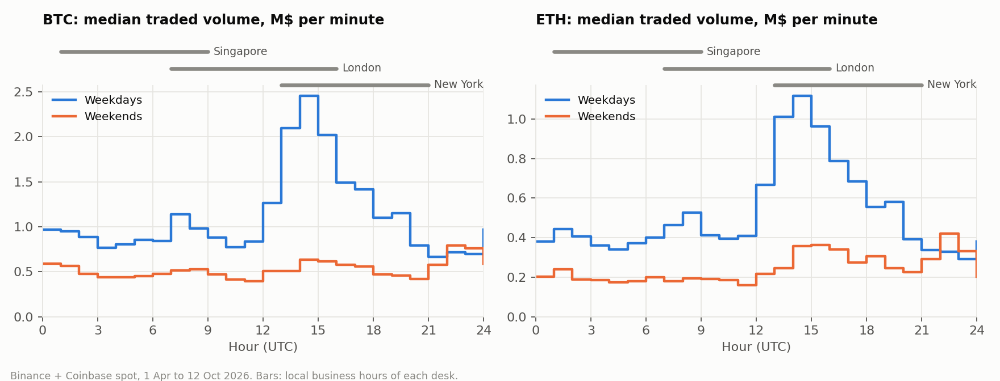
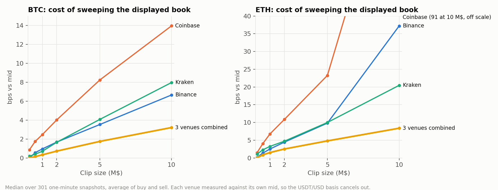
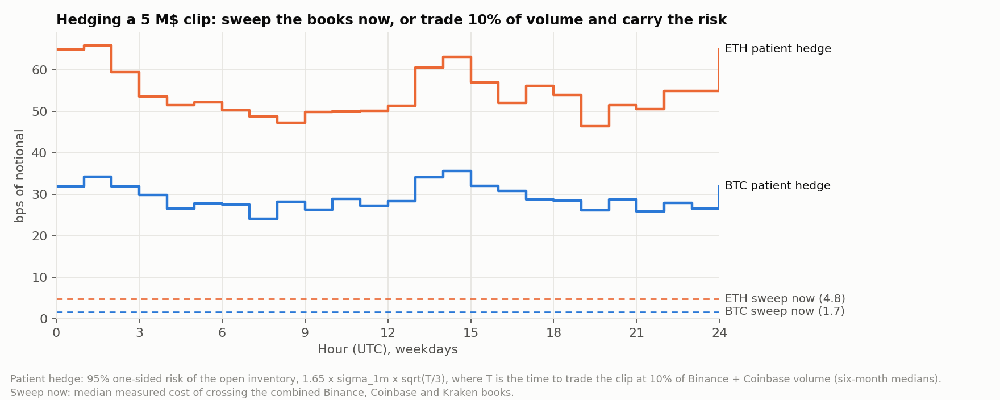

# Hedging a crypto OTC clip: what it costs, where and when

An OTC desk that fills a client's 5 M$ BTC order has to hedge it on lit venues. This project
measures what that hedge costs on Binance, Coinbase and Kraken, how much routing across the
three saves, and how the answer moves between the Singapore, London and New York sessions.
It ends in an Excel pricer that turns a client request into a quote.

**Data:** 1-minute snapshots of the six order books (BTC and ETH on three venues), recorded
live from 12 October 2026, plus six months of 1-minute candles from Binance and Coinbase
(1 April to 12 October 2026, 280,000 minutes per series).

## Findings

1. **Routing halves the cost.** Sweeping a 5 M$ clip costs 1.75 bps on the combined books
   against 3.5 bps on the best single venue for BTC (4.8 against 9.8 bps for ETH). On a BTC
   clip that is about 900 $ saved. The combined fill takes about 46% from Binance, 37% from
   Kraken and 15% from Coinbase.
2. **New York open is the only real liquidity peak.** On weekdays, BTC trades 2.2 M$ per
   minute between 13:00 and 16:00 UTC, against 0.9 M$ in London morning and 0.85 M$ in Asian
   hours: London morning is barely more liquid than Asia. Volume bottoms out at 21:00 UTC and
   weekends trade about 45% less than weekdays.
3. **Each venue follows its home time zone.** Coinbase's share of volume falls from 48% at
   19:00 UTC to 16% at 07:00 UTC, and its displayed depth with it: a 5 M$ sweep on Coinbase
   cost 11.0 bps in London morning against 7.5 bps in the New York afternoon for BTC (32
   against 22 bps for ETH), while Binance barely moved (3.5 against 3.6 bps for BTC). Outside
   US hours the combined book leans on Binance and Kraken.
4. **Up to 10 M$, speed beats patience.** Working a 5 M$ BTC clip at 10% of volume takes
   20 to 75 minutes and leaves 24 to 36 bps of open risk (95%), against 1.75 bps to sweep the
   combined books at once. The hour changes the risk of waiting far more than the cost of
   sweeping.







### Measured cost of a 5 M$ clip, by session (bps, median)

| Asset | Session | Minutes | 3 venues combined | Best single venue |
|---|---|---:|---:|---:|
| BTC | New York afternoon (12 Oct, 17:23–20:06 UTC) | 164 | 1.69 | 3.54 |
| BTC | London morning (13 Oct, 07:12–09:28 UTC) | 137 | 1.87 | 3.48 |
| ETH | New York afternoon (12 Oct, 17:23–20:06 UTC) | 164 | 4.52 | 8.98 |
| ETH | London morning (13 Oct, 07:12–09:28 UTC) | 137 | 5.00 | 10.21 |

The full table is in [`reports/sessions_measured.csv`](reports/sessions_measured.csv).

## Excel pricer

[`reports/otc_clip_pricer.xlsx`](reports/otc_clip_pricer.xlsx) uses live formulas, with no
values pasted in:

- **Pricer:** the trader enters asset, client side, size, hour, day and margin. The sheet
  interpolates the measured sweep cost for that size and session, compares it with the risk of
  working the order at that hour, and returns the spread, the client price, the expected desk
  P&L and the saving against a single venue.
- **Quote grid:** spread to quote by clip size and session.
- **Cost of waiting:** risk of working the clip, for every hour, weekday and weekend.

Example: a client buys 5 M$ of BTC at 09:00 UTC on a weekday, with a 2 bps margin. The pricer
uses the London morning curve, quotes 3.9 bps above mid and recommends sweeping the combined
books. Hedging on a single venue would cost about 800 $ more.

## Method

- **Sweep cost:** walk the displayed book until the clip is filled, take the VWAP and measure it
  against the venue's own mid, in bps. Measuring each venue against its own mid cancels the
  USDT/USD basis between Binance and the USD venues (about 12 bps on BTC on 12 October). The
  cost of a clip is the average of the buy and sell sweeps.
- **Combined book:** the three books merged in bps-from-mid space, filled from the cheapest
  level, venue by venue.
- **Liquidity clock:** median over days of the hourly volume and of the root mean square
  1-minute return, by hour of the week.
- **Working the order:** at a participation rate p, the clip takes T = Q / (p × V) minutes. With
  a linear trajectory the open inventory falls to zero, so the standard deviation of the P&L is
  σ₁ₘ × √(T/3) (Almgren and Chriss, 2000). The risk shown is 1.65 times that (one-sided 95%).

## Limits

- Snapshots show displayed liquidity only: no hidden orders, no refill after a sweep, no market
  makers pulling their quotes, no fees. Read the sweep cost as a lower bound for an aggressive
  hedge.
- The books cover two sessions: the New York afternoon and the London morning. Asia was not
  recorded in the books; for Asian hours the history gives volume and volatility, not sweep
  costs.
- Volume counts Binance and Coinbase only, so the time to work a clip is overstated.

## Run

```bash
pip install -r requirements.txt
run_collector.bat                    # minute snapshots, restarts itself; create data/STOP to stop
python analysis/fetch_history.py     # six months of 1-minute candles
python analysis/build.py             # figures and tables in reports/
python analysis/pricer.py            # Excel pricer
python analysis/check_excel.py       # evaluates every formula of the pricer
python status.py                     # collection coverage and gaps
```

- `collector/collect.py`: fetches the six books every minute and writes `data/metrics.csv`
  (costs and depth) and the raw books truncated to ±150 bps (`data/raw/`, not versioned)
- `analysis/`: history download, figures, Excel pricer
